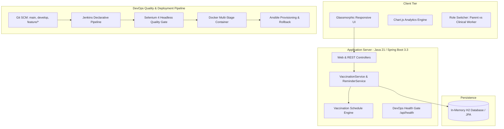

# 💉 VaxGuard - Vaccination Reminder Portal
### DevOps Automated Selenium Testing Pipeline, Docker CI/CD & Ansible Provisioning

[](https://github.com/gayatri-patil/vaccination-reminder-portal)
[](https://github.com/gayatri-patil/vaccination-reminder-portal)
[](https://github.com/gayatri-patil/vaccination-reminder-portal)
[](https://github.com/gayatri-patil/vaccination-reminder-portal)
[](https://github.com/gayatri-patil/vaccination-reminder-portal)
[](https://github.com/gayatri-patil/vaccination-reminder-portal)

---

## 🎓 Academic Project Profile
- **Candidate Name:** Gayatri Patil
- **Student ID / PRN:** `23102A0016`
- **Roll Number:** `16`
- **Project Title:** Selenium Testing Pipeline for a Vaccination Reminder Portal
- **Release Version:** `v1.0.0` (Production Baseline)

---

## 📌 Project Overview
**VaxGuard** is an automated cloud-native healthcare platform designed to prevent infant immunization drop-out. The portal automatically computes standard national immunization schedules from a child's Date of Birth (DOB), enforces role-based clinical status transitions, provides real-time KPI metrics and Chart.js analytics, and simulates proactive SMS alerts to parents.

The repository incorporates a full-lifecycle **DevOps pipeline**:
- **Automated Quality Gate:** 5 Selenium WebDriver end-to-end user journeys executed in headless mode with automated failure screenshot capture.
- **Continuous Integration:** Declarative Jenkins pipeline enforcing automated test quality gates before packaging.
- **Containerization:** Secure, non-root multi-stage Docker image with built-in health probes.
- **Configuration Management:** Automated, idempotent Ansible provisioning playbook with verified rollback capability.

---

## 📑 15-Stage DevOps Deliverables Dossier

Full academic deliverables are documented in individual dossiers in the [`docs/`](file:///c:/Users/ishwar/Desktop/devops%20gayatri/docs/) directory:

| Task # | Syllabus Deliverable Title | Documentation Dossier Link | Status |
| :---: | :--- | :--- | :---: |
| **01** | Problem Definition and Scope | [TASK-01 Documentation](file:///c:/Users/ishwar/Desktop/devops%20gayatri/docs/TASK-01-Problem-Definition-and-Scope.md) | ✅ Complete |
| **02** | Agile Planning & DevOps Workflow | [TASK-02 Documentation](file:///c:/Users/ishwar/Desktop/devops%20gayatri/docs/TASK-02-Agile-Planning-and-DevOps-Workflow.md) | ✅ Complete |
| **03** | Requirements & Technology Architecture | [TASK-03 Documentation](file:///c:/Users/ishwar/Desktop/devops%20gayatri/docs/TASK-03-Requirements-Architecture-and-Tech-Setup.md) | ✅ Complete |
| **04** | Git & Repository Initialization | [TASK-04 Documentation](file:///c:/Users/ishwar/Desktop/devops%20gayatri/docs/TASK-04-Git-Repository-Initialization.md) | ✅ Complete |
| **05** | Feature Development on Branch | [TASK-05 Documentation](file:///c:/Users/ishwar/Desktop/devops%20gayatri/docs/TASK-05-Feature-Development-Branching.md) | ✅ Complete |
| **06** | MVP Completion & Git Collaboration | [TASK-06 Documentation](file:///c:/Users/ishwar/Desktop/devops%20gayatri/docs/TASK-06-MVP-Completion-and-Git-Collaboration.md) | ✅ Complete |
| **07** | Jenkins Installation & CI Build Job | [TASK-07 Documentation](file:///c:/Users/ishwar/Desktop/devops%20gayatri/docs/TASK-07-Jenkins-Installation-and-Continuous-Integration-Job.md) | ✅ Complete |
| **08** | Pipeline as Code (Jenkinsfile) | [TASK-08 Documentation](file:///c:/Users/ishwar/Desktop/devops%20gayatri/docs/TASK-08-Pipeline-as-Code-Jenkinsfile.md) | ✅ Complete |
| **09** | Selenium Test Design & Execution | [TASK-09 Documentation](file:///c:/Users/ishwar/Desktop/devops%20gayatri/docs/TASK-09-Selenium-Test-Design-and-Execution.md) | ✅ Complete |
| **10** | Continuous Testing Quality Gate | [TASK-10 Documentation](file:///c:/Users/ishwar/Desktop/devops%20gayatri/docs/TASK-10-Continuous-Testing-Jenkins-Quality-Gate.md) | ✅ Complete |
| **11** | Docker Image & Container Lifecycle | [TASK-11 Documentation](file:///c:/Users/ishwar/Desktop/devops%20gayatri/docs/TASK-11-Docker-Image-and-Container-Lifecycle.md) | ✅ Complete |
| **12** | Jenkins-Docker CD Deployment | [TASK-12 Documentation](file:///c:/Users/ishwar/Desktop/devops%20gayatri/docs/TASK-12-Jenkins-Docker-Continuous-Deployment.md) | ✅ Complete |
| **13** | Configuration Management (Ansible) | [TASK-13 Documentation](file:///c:/Users/ishwar/Desktop/devops%20gayatri/docs/TASK-13-Configuration-Management-Ansible.md) | ✅ Complete |
| **14** | Automated Provisioning & Rollback | [TASK-14 Documentation](file:///c:/Users/ishwar/Desktop/devops%20gayatri/docs/TASK-14-Automated-Provisioning-and-Reliability.md) | ✅ Complete |
| **15** | Final Release Report & Viva Prep | [TASK-15 Documentation](file:///c:/Users/ishwar/Desktop/devops%20gayatri/docs/TASK-15-Final-Project-Report-and-Viva-Prep.md) | ✅ Complete |

---

## 🏛️ System Architecture



---

## ⚡ Quick Start Guide

### 1. Compile and Run Locally
```powershell
# Compile Java source code
.\mvnw.cmd clean compile

# Run all automated Selenium end-to-end tests
.\mvnw.cmd test

# Package the executable JAR
.\mvnw.cmd package -DskipTests

# Run the web application
java -jar target/vaccination-reminder-portal-1.0.0.jar
```
Visit the web portal in your browser at: **`http://localhost:8080`**  
DevOps Health Probe: **`http://localhost:8080/api/health`**  
H2 Database Console: **`http://localhost:8080/h2-console`**

---

### 2. Docker Container Lifecycle Commands
```powershell
# Build multi-stage Docker image
docker build -t vaxguard/vaccination-portal:1.0.0 -f docker/Dockerfile .

# Run container with port mapping
docker run -d --name vaxguard-app -p 8080:8080 vaxguard/vaccination-portal:1.0.0

# Inspect container status and health
docker ps --filter "name=vaxguard-app"

# View logs
docker logs --tail 25 vaxguard-app

# Automated full lifecycle script
.\docker\container-lifecycle.ps1
```

---

### 3. Automated Provisioning with Ansible
```bash
# Execute idempotent server provisioning
ansible-playbook -i ansible/inventory.ini ansible/playbook.yml

# Re-run to verify idempotency (0 changed tasks)
ansible-playbook -i ansible/inventory.ini ansible/playbook.yml

# Execute automated rollback demonstration
ansible-playbook -i ansible/inventory.ini ansible/rollback.yml
```

---

## 🧪 Automated Selenium Testing Suite

The testing suite in `src/test/java/com/vaxguard/selenium/` validates 5 critical user journeys:

1. **`BeneficiaryRegistrationJourneyTest`:** Registers a new infant, validates form feedback, verifies record persistence, and confirms 16 immunization doses are calculated from birth to 24 months.
2. **`SearchAndFilterJourneyTest`:** Filters vaccination doses by status (`COMPLETED`, `OVERDUE`) and searches records by child name and parent phone.
3. **`StatusWorkflowJourneyTest`:** Validates clinical nurse administration workflow, updates status to `COMPLETED` with nurse notes and lot numbers, and ensures Parent View role restrictions.
4. **`DashboardMetricsJourneyTest`:** Verifies real-time summary KPI cards, Chart.js canvas render, and proactive batch reminder triggers.
5. **`DefectSimulationJourneyTest` (Task 10):** Deliberately triggers a validation defect caught by the Jenkins quality gate, captures failure screenshots into `target/screenshots/`, and validates automated remediation.

---

## 👩‍💻 Author & Academic Attribution
- **Student:** Gayatri Patil
- **PRN:** `23102A0016`
- **Roll Number:** `16`
- **Class / Department:** Computer Engineering / DevOps Lab
