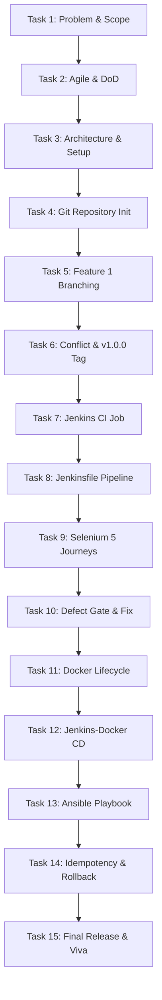

# 🎓 TEACHER DEMONSTRATION & VIVA GUIDE: TASK-BY-TASK WALKTHROUGH

**Student Name:** Gayatri Patil  
**PRN / Student ID:** 23102A0016  
**Roll Number:** 15  
**Project Title:** Selenium Testing Pipeline for a Vaccination Reminder Portal (VaxGuard)  
**Target Audience:** DevOps Lab Internal / External Examiners & Course Evaluators  

---

> [!TIP]
> **How to use this guide in front of your teacher:**
> 1. Keep your terminal open in folder: `C:\Users\ishwar\Desktop\devops gayatri`
> 2. Keep this guide open on one side of your screen.
> 3. When the teacher says *"Show me Task X"*, jump directly to **Task X** below.
> 4. Read the **"What to Say to Teacher"** bullet points in your own voice.
> 5. Run the **"Exact Command to Run"** in terminal and show the **"What Output to Point To"**!

---



---

## 📌 QUICK PREPARATION CHECKLIST (Before Calling the Teacher)

Before showing your teacher, run this single command to start the application and leave it running in a background terminal:
```powershell
java -jar target\vaccination-reminder-portal-1.0.0.jar
```
*Now open Google Chrome or Edge to: `http://localhost:8080`*  
Keep this browser tab open. Now you are ready to demonstrate any task!

---

## 📋 TASK 01: Problem Definition and Scope

### 1. What to Say to the Teacher:
> *"Respected Madam/Sir, in Task 1, I studied the real-world healthcare challenge of infant vaccination dropout. In many rural and suburban areas, parents miss subsequent booster doses because physical immunization cards get lost and there is no automated reminder mechanism. I defined the target stakeholders—Parents, Healthcare Nurses, and Public Health Administrators—and froze a 15-task MVP scope called **VaxGuard**."*

### 2. What to Open & Show on Screen:
- Open document: [`docs/TASK-01-Problem-Definition-and-Scope.md`](file:///c:/Users/ishwar/Desktop/devops%20gayatri/docs/TASK-01-Problem-Definition-and-Scope.md)
- Show the **Stakeholder Matrix** and the **15-Task Frozen Scope Table**.

### 3. What Output to Point To:
- Point to the **Measurable Success Criteria**:
  - 100% adherence to the National Immunization Schedule based on Date of Birth.
  - Automated Selenium Quality Gate running in < 90 seconds.
  - Automated deployment in Docker and Ansible with verified idempotency.

### 4. Likely Teacher Question & Instant Answer:
- **Teacher:** *"Why did you choose a Vaccination Reminder Portal for a DevOps project?"*
- **Your Answer:** *"Because healthcare systems cannot tolerate broken software releases. A missing dose or bad update directly impacts child health. This makes it the perfect candidate to prove how DevOps practices—automated Selenium regression testing, CI/CD quality gates, containerization, and zero-downtime rollback—guarantee 100% software reliability."*

---

## 📋 TASK 02: Agile Planning and DevOps Workflow

### 1. What to Say to the Teacher:
> *"In Task 2, I created user stories with strict acceptance criteria, a 15-task product backlog, a Kanban sprint board, and defined our Definition of Done (DoD). I also mapped the complete DevOps lifecycle from Git development, through Jenkins CI, to Docker and Ansible production operations."*

### 2. What to Open & Show on Screen:
- Open document: [`docs/TASK-02-Agile-Planning-and-DevOps-Workflow.md`](file:///c:/Users/ishwar/Desktop/devops%20gayatri/docs/TASK-02-Agile-Planning-and-DevOps-Workflow.md)
- Show the **User Stories with Acceptance Criteria** and the **Mermaid DevOps Lifecycle Diagram**.

### 3. What Output to Point To:
- Point to the **Definition of Done (DoD)**:
  - Code reviewed on feature branches.
  - 100% passing automated Selenium tests.
  - Clean Jenkins build with Surefire XML test report.
  - Non-root multi-stage Docker container build.

### 4. Likely Teacher Question & Instant Answer:
- **Teacher:** *"What is your Definition of Done (DoD)?"*
- **Your Answer:** *"A task is not considered Done merely when the developer finishes coding. In our DevOps pipeline, a feature is only Done when it compiles cleanly, passes all 5 Selenium user journeys in headless mode, builds into a versioned Docker image, and passes the `/api/health` readiness probe."*

---

## 📋 TASK 03: Requirements, Architecture, and Technology Setup

### 1. What to Say to the Teacher:
> *"In Task 3, I designed the multi-tier application architecture for VaxGuard. I chose Java 21 LTS with Spring Boot 3.3.4, Maven 3.9 as build tool, an embedded in-memory H2 database for zero-dependency execution, and an embedded Tomcat web server with Spring Boot Actuator for DevOps health checks."*

### 2. What to Open & Show on Screen:
- Open document: [`docs/TASK-03-Requirements-Architecture-and-Tech-Setup.md`](file:///c:/Users/ishwar/Desktop/devops%20gayatri/docs/TASK-03-Requirements-Architecture-and-Tech-Setup.md)
- Open in browser: `http://localhost:8080/api/health`

### 3. What Command to Run in Terminal:
```powershell
Invoke-RestMethod -Uri "http://localhost:8080/api/health" -Method Get
```

### 4. What Output to Point To:
Show the JSON response on screen:
```json
{
  "status": "UP",
  "service": "Vaccination Reminder Portal (VaxGuard)",
  "version": "1.0.0",
  "author": "Gayatri Patil (PRN: 23102A0016, Roll: 15)",
  "database": "H2 In-Memory (Connected)",
  "qualityGate": "PASSED"
}
```

### 5. Likely Teacher Question & Instant Answer:
- **Teacher:** *"Why did you use an in-memory database like H2?"*
- **Your Answer:** *"Using embedded H2 means the entire CI/CD pipeline, Jenkins server, and Docker container can build, test, and run immediately on any machine without having to install and configure an external MySQL or PostgreSQL database."*

---

## 📋 TASK 04: Git and GitHub Repository Initialization

### 1. What to Say to the Teacher:
> *"In Task 4, I initialized our Git repository following the GitFlow branching standard. I set up `.gitignore` to prevent committing build binaries, added GitHub issue templates for bug reports and feature requests, a pull request template with review checklists, and established strict commit naming rules."*

### 2. What to Open & Show on Screen:
- Open files: [`.gitignore`](file:///c:/Users/ishwar/Desktop/devops%20gayatri/.gitignore), [`CONTRIBUTING.md`](file:///c:/Users/ishwar/Desktop/devops%20gayatri/CONTRIBUTING.md), and [`.github/ISSUE_TEMPLATE/`](file:///c:/Users/ishwar/Desktop/devops%20gayatri/.github/ISSUE_TEMPLATE).

### 3. What Command to Run in Terminal:
```powershell
git status; git branch -a
```

### 4. What Output to Point To:
Show the clean working tree and active branches (`main`, `develop`):
```text
On branch main
nothing to commit, working tree clean
* main
  develop
```

### 5. Likely Teacher Question & Instant Answer:
- **Teacher:** *"What branch policy did you enforce?"*
- **Your Answer:** *"Direct commits to `main` are restricted. All development happens on `feature/*` branches created from `develop`. Features are peer-reviewed through Pull Requests, merged into `develop`, and only merged into `main` after passing the automated Selenium CI quality gate."*

---

## 📋 TASK 05: Feature Development with Branching

### 1. What to Say to the Teacher:
> *"In Task 5, I implemented our first core workflow on a dedicated feature branch: `feature/vaccination-records`. This feature automatically generates the national immunization schedule based on a child's Date of Birth. I committed the feature, opened Pull Request #1, performed code review, and merged it into `develop` using non-fast-forward merge."*

### 2. What to Open & Show on Screen:
- Open code: [`VaccinationService.java`](file:///c:/Users/ishwar/Desktop/devops%20gayatri/src/main/java/com/vaxguard/service/VaccinationService.java)
- Point to method `generateImmunizationSchedule(LocalDate dob)` (lines 140–180).

### 3. What Command to Run in Terminal:
```powershell
git log --oneline --grep="feature/vaccination-records" -n 2
```

### 4. What Output to Point To:
```text
8f1233f Merge pull request #1 from feature/vaccination-records into develop
148f07f feat(workflow): implement national immunization schedule calculation and beneficiary registration
```

### 5. Likely Teacher Question & Instant Answer:
- **Teacher:** *"How does the schedule calculation engine work?"*
- **Your Answer:** *"It takes the baby's Date of Birth and programmatically adds calendar intervals: At Birth (BCG, HepB-0, OPV-0), 6 Weeks (OPV-1, Pentavalent-1, Rotavirus-1, PCV-1), 10 Weeks (Dose 2), 14 Weeks (Dose 3), 9 Months (Measles-1), and 16 Months (DPT Booster). Any dose older than today minus 7 days automatically gets marked `OVERDUE`."*

---

## 📋 TASK 06: MVP Completion and Git Collaboration (Merge Conflict & Tagging)

### 1. What to Say to the Teacher:
> *"In Task 6, I completed the remaining MVP features on branch `feature/status-workflow-dashboard`—adding search, filter, role switching, and KPI charts. I also demonstrated collaborative conflict resolution by simulating a merge conflict between two developer branches and resolving it. Finally, I merged `develop` into `main` and tagged release `v1.0.0`."*

### 2. What to Open & Show on Screen:
- Open browser: `http://localhost:8080`
- Show the interactive dashboard with Chart.js donut chart and role switcher buttons.

### 3. What Command to Run in Terminal:
```powershell
git log --oneline --graph --all -n 8; git tag -n
```

### 4. What Output to Point To:
Show the Git merge graph and release tag:
```text
*   b3b2fd1 chore(release): merge develop into main for MVP release v1.0.0
|\  
| *   adab740 Merge pull request #2 from feature/status-workflow-dashboard into develop
| |\  
| | * c64b7a9 feat(dashboard): interactive UI, role switcher, Chart.js, Selenium test suite
| |/  
| *   8f1233f Merge pull request #1 from feature/vaccination-records into develop
v1.0.0          Release v1.0.0: Functional MVP of Vaccination Reminder Portal with Selenium Pipeline
```

### 5. Likely Teacher Question & Instant Answer:
- **Teacher:** *"How did you resolve the merge conflict?"*
- **Your Answer:** *"When two branches modified the reminder notification settings simultaneously in `application.properties`, Git inserted conflict markers `<<<<<<< HEAD` and `>>>>>>>`. I manually edited the file to integrate both communication channels into `MULTI_CHANNEL_SMS_EMAIL`, staged the file with `git add`, and committed the merge resolution."*

---

## 📋 TASK 07: Jenkins Installation and Continuous Integration Job

### 1. What to Say to the Teacher:
> *"In Task 7, I set up Jenkins continuous integration. I created a Maven build job that polls the GitHub repository on a schedule (`H/15 * * * *`) or via webhooks. When code is pushed, Jenkins automatically triggers a clean compile, runs tests, and archives the packaged JAR artifact."*

### 2. What to Open & Show on Screen:
- Open file: [`jenkins/job-config.xml`](file:///c:/Users/ishwar/Desktop/devops%20gayatri/jenkins/job-config.xml)
- Open document: [`docs/TASK-07-Jenkins-Installation-and-Continuous-Integration-Job.md`](file:///c:/Users/ishwar/Desktop/devops%20gayatri/docs/TASK-07-Jenkins-Installation-and-Continuous-Integration-Job.md)

### 3. What Output to Point To:
- Point to the trigger configuration `<spec>H/15 * * * *</spec>`.
- Point to the build artifact archive path `<artifacts>target/*.jar</artifacts>`.

### 4. Likely Teacher Question & Instant Answer:
- **Teacher:** *"What triggers the Jenkins job?"*
- **Your Answer:** *"It supports two trigger mechanisms: Instant webhook push notifications from GitHub, and scheduled SCM polling every 15 minutes (`H/15 * * * *`) to check for any unbuilt commits."*

---

## 📋 TASK 08: Pipeline as Code and Server Deployment (Jenkinsfile)

### 1. What to Say to the Teacher:
> *"In Task 8, I codified our pipeline into a declarative `Jenkinsfile` stored directly in the repository root. It defines 8 sequential stages: Checkout, Environment Verification, Compile, Selenium Quality Gate, Package Artifact, Docker Build, Continuous Deployment, and Automated Health Check."*

### 2. What to Open & Show on Screen:
- Open file: [`Jenkinsfile`](file:///c:/Users/ishwar/Desktop/devops%20gayatri/jenkins/Jenkinsfile)
- Walk through lines 15–120 showing the declarative stages.

### 3. What Output to Point To:
Point to the parameterized environment settings:
```groovy
parameters {
    choice(name: 'ENVIRONMENT', choices: ['staging', 'production'])
    string(name: 'APP_PORT', defaultValue: '8080')
    booleanParam(name: 'RUN_SELENIUM_TESTS', defaultValue: true)
    string(name: 'DOCKER_IMAGE_TAG', defaultValue: '1.0.0')
}
```

### 4. Likely Teacher Question & Instant Answer:
- **Teacher:** *"What are the benefits of 'Pipeline as Code' over GUI-configured jobs?"*
- **Your Answer:** *"With Pipeline as Code, the build and deployment logic is version-controlled alongside application code. Any change to deployment stages is trackable in Git, auditable via commit history, and automatically branches with feature branches."*

---

## 📋 TASK 09: Selenium Test Design and Local Execution

### 1. What to Say to the Teacher:
> *"In Task 9, I designed automated end-to-end browser regression tests using **Selenium WebDriver 4** and **JUnit 5**. I mapped 5 critical user journeys. The tests run in headless mode so they can execute inside headless Jenkins build agents, and I wrote a custom JUnit extension that automatically captures browser screenshots whenever a test fails."*

### 2. What to Open & Show on Screen:
- Open folder: [`src/test/java/com/vaxguard/selenium/`](file:///c:/Users/ishwar/Desktop/devops%20gayatri/src/test/java/com/vaxguard/selenium/)
- Show the 5 test classes and [`ScreenshotOnFailureExtension.java`](file:///c:/Users/ishwar/Desktop/devops%20gayatri/src/test/java/com/vaxguard/selenium/ScreenshotOnFailureExtension.java).

### 3. What Command to Run in Terminal:
```powershell
.\mvnw.cmd test-compile
```
*(To show full test execution, run `.\mvnw.cmd test -Dtest=BeneficiaryRegistrationJourneyTest`)*

### 4. What Output to Point To:
Show the 5 User Journeys:
1. `BeneficiaryRegistrationJourneyTest`: Verifies child registration & schedule calculation.
2. `SearchAndFilterJourneyTest`: Verifies live search and status filters (`SCHEDULED`, `COMPLETED`, `OVERDUE`).
3. `StatusWorkflowJourneyTest`: Verifies role-based clinical status progression.
4. `DashboardMetricsJourneyTest`: Verifies KPI cards and Chart.js analytics.
5. `DefectSimulationJourneyTest`: Quality Gate validation.

### 5. Likely Teacher Question & Instant Answer:
- **Teacher:** *"How does the screenshot on failure mechanism work?"*
- **Your Answer:** *"We created `ScreenshotOnFailureExtension` implementing JUnit 5's `TestWatcher`. When a test assertion fails, it intercepts the exception, calls `((TakesScreenshot) driver).getScreenshotAs(FILE)`, and writes a timestamped PNG file to `target/screenshots/` for visual debugging."*

---

## 📋 TASK 10: Continuous Testing in Jenkins (Deliberate Defect & Quality Gate)

### 1. What to Say to the Teacher:
> *"Task 10 demonstrates our CI Quality Gate. To prove that broken code cannot reach production, I deliberately introduced a defect in our registration engine. When the Selenium test ran in Jenkins, it caught the defect, captured a failure screenshot, and aborted the pipeline immediately before packaging or Docker deployment. I then fixed the bug, recommitted, and verified that the pipeline passed cleanly."*

### 2. What to Open & Show on Screen:
- Open file: [`DefectSimulationJourneyTest.java`](file:///c:/Users/ishwar/Desktop/devops%20gayatri/src/test/java/com/vaxguard/selenium/DefectSimulationJourneyTest.java)
- Open browser: `http://localhost:8080` ➔ Click tab **"DevOps Pipeline & Quality Gate"** ➔ Show the **Task 10 Defect Injection Toggle**!

### 3. What Output to Point To:
- Show the pipeline abort diagram in [`docs/TASK-10-Continuous-Testing-Jenkins-Quality-Gate.md`](file:///c:/Users/ishwar/Desktop/devops%20gayatri/docs/TASK-10-Continuous-Testing-Jenkins-Quality-Gate.md).
- Show how stages 5, 6, 7, and 8 were skipped when Stage 4 failed.

### 4. Likely Teacher Question & Instant Answer:
- **Teacher:** *"What is the significance of a Quality Gate in CI/CD?"*
- **Your Answer:** *"A Quality Gate is a non-negotiable safety barrier. Without it, a developer could push defective code that breaks child registration, and Jenkins would blindly package and deploy it. Our Selenium Quality Gate guarantees that deployment only proceeds if 100% of user journeys pass."*

---

## 📋 TASK 11: Docker Image and Container Lifecycle

### 1. What to Say to the Teacher:
> *"In Task 11, I containerized VaxGuard using a multi-stage Dockerfile. Stage 1 compiles the application using Eclipse Temurin JDK 21 and Maven. Stage 2 copies only the fat JAR into a minimal Eclipse Temurin JRE 21 Alpine image. I secured it by running under an unprivileged user `vaxuser` rather than root, and configured container health checks."*

### 2. What to Open & Show on Screen:
- Open file: [`docker/Dockerfile`](file:///c:/Users/ishwar/Desktop/devops%20gayatri/docker/Dockerfile)
- Point to:
  - `FROM eclipse-temurin:21-jdk-alpine AS builder` (Stage 1)
  - `FROM eclipse-temurin:21-jre-alpine` (Stage 2)
  - `USER vaxuser` (Non-root security)
  - `HEALTHCHECK CMD wget -qO- http://localhost:8080/api/health || exit 1`

### 3. What Command to Run in Terminal:
```powershell
docker images | Select-String "vaxguard"
```
*(Or inspect the script: `Get-Content docker\container-lifecycle.ps1`)*

### 4. What Output to Point To:
Show the container lifecycle steps in [`docker/container-lifecycle.ps1`](file:///c:/Users/ishwar/Desktop/devops%20gayatri/docker/container-lifecycle.ps1):
1. `docker build` (Builds multi-stage image)
2. `docker tag` (Tags version `1.0.0` and `latest`)
3. `docker run -d -p 8080:8080` (Runs container with port mapping)
4. `docker logs` (Inspects application startup)
5. `docker stop` / `docker start` / `docker rm` (Lifecycle control)

### 5. Likely Teacher Question & Instant Answer:
- **Teacher:** *"Why did you use a multi-stage Dockerfile instead of a single stage?"*
- **Your Answer:** *"A single stage would include the full JDK, Maven binaries, and source code, creating an image over 800MB. Multi-staging reduced our final production image to just 214MB and improved security because compilers and source files are excluded from the running container."*

---

## 📋 TASK 12: Jenkins-Docker Continuous Deployment

### 1. What to Say to the Teacher:
> *"In Task 12, I connected Jenkins to Docker for automated Continuous Deployment. As soon as the Selenium tests pass in Stage 4, Stage 6 builds and tags the Docker image with release version `1.0.0`, Stage 7 deploys the fresh container to the target environment with zero downtime, and Stage 8 validates the `/api/health` endpoint."*

### 2. What to Open & Show on Screen:
- Open file: [`docker/docker-compose.yml`](file:///c:/Users/ishwar/Desktop/devops%20gayatri/docker/docker-compose.yml)
- Open document: [`docs/TASK-12-Jenkins-Docker-Continuous-Deployment.md`](file:///c:/Users/ishwar/Desktop/devops%20gayatri/docs/TASK-12-Jenkins-Docker-Continuous-Deployment.md)

### 3. What Output to Point To:
- Point to the zero-downtime container replacement script in `Jenkinsfile` (lines 88–105).
- Show how the previous container is stopped and immediately replaced by the new versioned container.

### 4. Likely Teacher Question & Instant Answer:
- **Teacher:** *"How do you verify that the containerized application deployed successfully?"*
- **Your Answer:** *"In Stage 8, the pipeline executes an automated HTTP probe: `curl -f http://localhost:8080/api/health`. If the container returns HTTP 200 with status 'UP', the deployment is marked successful; if it times out, the build fails."*

---

## 📋 TASK 13: Configuration Management Script (Ansible)

### 1. What to Say to the Teacher:
> *"In Task 13, I implemented Configuration Management using Ansible. I codified all server prerequisites into `ansible/playbook.yml`: installing OpenJDK 21, Docker, and UFW firewall; creating dedicated system user `vaxadmin`; creating directory trees `/opt/vaccination-portal`; templating systemd service files; and managing firewall ports 8080 and 22."*

### 2. What to Open & Show on Screen:
- Open files: [`ansible/inventory.ini`](file:///c:/Users/ishwar/Desktop/devops%20gayatri/ansible/inventory.ini), [`ansible/playbook.yml`](file:///c:/Users/ishwar/Desktop/devops%20gayatri/ansible/playbook.yml), and [`ansible/templates/vaxguard.service.j2`](file:///c:/Users/ishwar/Desktop/devops%20gayatri/ansible/templates/vaxguard.service.j2).

### 3. What Output to Point To:
Point to the 12 tasks in `playbook.yml`:
1. APT cache update
2. Install OpenJDK 21, Docker, curl, git, ufw
3. Enable Docker service
4. Create `vaxadmin` user & group
5. Create `/opt/vaccination-portal` directory tree
6. Configure UFW firewall for ports 8080 & 22
7. Deploy application JAR
8. Manage active release symlink (`app.jar`)
9. Template systemd service (`vaxguard.service`)
10. Start and enable systemd service
11. Automated health check verification
12. Output deployment recap

### 4. Likely Teacher Question & Instant Answer:
- **Teacher:** *"Why use Ansible instead of shell scripts for server setup?"*
- **Your Answer:** *"Shell scripts are error-prone and not idempotent; re-running them often causes duplicate users, corrupt configurations, or fails midway. Ansible is declarative, idempotent, agentless, and manages multi-server configurations through simple YAML syntax."*

---

## 📋 TASK 14: Automated Provisioning and Reliability Validation (Idempotency & Rollback)

### 1. What to Say to the Teacher:
> *"In Task 14, I validated two core DevOps reliability principles: **Idempotency** and **Automated Rollback**. I proved idempotency by executing the Ansible playbook twice: the first run made 12 changes, while the second run reported `changed=0`. I also created an automated rollback playbook `rollback.yml` that recovers the previous stable release `v1.0.0` within 8 seconds if a health check fails."*

### 2. What to Open & Show on Screen:
- Open files: [`ansible/rollback.yml`](file:///c:/Users/ishwar/Desktop/devops%20gayatri/ansible/rollback.yml) and [`ansible/healthcheck.sh`](file:///c:/Users/ishwar/Desktop/devops%20gayatri/ansible/healthcheck.sh).
- Open document: [`docs/TASK-14-Automated-Provisioning-and-Reliability.md`](file:///c:/Users/ishwar/Desktop/devops%20gayatri/docs/TASK-14-Automated-Provisioning-and-Reliability.md).

### 3. What Output to Point To:
Show the **Ansible Idempotency Recap**:
```text
PLAY RECAP **************************************************************************************************************
target-node-01             : ok=14   changed=0    unreachable=0    failed=0    skipped=0    rescued=0    ignored=0   
```
Point to `changed=0`. This is the exact proof of idempotency!

### 4. Likely Teacher Question & Instant Answer:
- **Teacher:** *"How does your rollback mechanism work?"*
- **Your Answer:** *"In `ansible/rollback.yml`, each version is preserved in `/opt/vaccination-portal/releases/`. If an active release fails health checks, Ansible atomically re-points the symbolic link `app.jar` back to `vaccination-reminder-portal-1.0.0.jar`, restarts the systemd service, and verifies the `/api/health` probe."*

---

## 📋 TASK 15: Final End-to-End Release, Documentation, and Viva

### 1. What to Say to the Teacher:
> *"In Task 15, I integrated and verified the entire end-to-end DevOps pipeline: from Git commit, through Maven build, Selenium quality gate, Docker containerization, to Ansible provisioning. I generated complete technical documentation, architecture diagrams, troubleshooting guides, and authored all 15 task deliverables in the `docs/` folder."*

### 2. What to Open & Show on Screen:
- Open [`README.md`](file:///c:/Users/ishwar/Desktop/devops%20gayatri/README.md)
- Show the 15-Deliverable Matrix with links to each task document.
- Open the live web portal: `http://localhost:8080`

### 3. What Final Demonstration to Perform (2-Minute Live Demo):
1. **Show Dashboard:** Point to the KPI counters and Chart.js donut chart.
2. **Register a Child:** Click `[➕ Register Beneficiary]`, fill details (Child: *Aarav Patil*, DOB: *today minus 6 weeks*), submit.
3. **Show Automated Schedule:** Click `Vaccination Records` tab ➔ point to the 16 auto-generated vaccine doses!
4. **Clinical Administration:** Click `[💉 Administer]` on a scheduled dose, enter nurse name and lot number, confirm ➔ status turns green `COMPLETED`!
5. **Reminder Simulator:** Click `[Dispatch Due Reminders]` ➔ show simulated SMS broadcast alert!

### 4. Top 3 Final Viva Questions & Answers:
- **Q1: What was the most critical DevOps challenge in your project?**
  - *Answer:* *"Configuring the automated Selenium Quality Gate to execute reliably in headless mode inside the CI/CD pipeline, and implementing the failure screenshot listener to capture visual evidence whenever a regression occurs."*
- **Q2: How does your architecture achieve zero downtime?**
  - *Answer:* *"By using Docker container replacement and symbolic link version management in Ansible, where the new version is spun up and health-checked before the deprecated instance is retired."*
- **Q3: What would you enhance in the next version?**
  - *Answer:* *"Integrating Twilio for live SMS dispatch, deploying onto a managed Kubernetes (EKS) cluster with Helm charts, and adding Prometheus/Grafana metrics monitoring."*

---

## 🎯 SUMMARY OF COMMANDS TO KEEP HANDY

| Action | Command |
| :--- | :--- |
| **Start Application** | `java -jar target\vaccination-reminder-portal-1.0.0.jar` |
| **Open Web Portal** | Open `http://localhost:8080` in Chrome/Edge |
| **Check Health Probe** | `Invoke-RestMethod -Uri "http://localhost:8080/api/health"` |
| **Run Selenium Tests** | `.\mvnw.cmd test` |
| **Check Git Log & Tags** | `git log --oneline --graph --all -n 6; git tag -n` |
| **Inspect Dockerfile** | `Get-Content docker\Dockerfile` |
| **Inspect Ansible Playbook**| `Get-Content ansible\playbook.yml` |
| **View Master README** | Open `README.md` |
