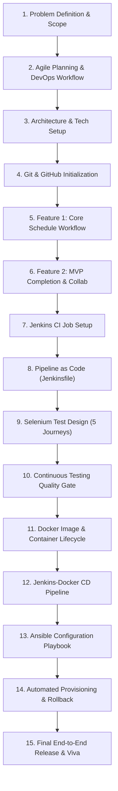

# TASK 01: Problem Definition, Stakeholders, and Scope Specification

**Student:** Gayatri Patil  
**PRN / Roll No:** 23102A0016 / Roll 15  
**Project:** Selenium Testing Pipeline for a Vaccination Reminder Portal (VaxGuard)  
**Deliverable:** Problem statement, stakeholder list, objectives, constraints, and approved 15-task MVP scope.

---

## 1. Executive Summary & Problem Definition

### 1.1 The Real-World Need
Immunization is one of the most effective global health interventions, saving over 4 million lives annually. However, according to WHO and UNICEF estimates, approximately 20 million infants worldwide either miss their primary doses or drop out of vaccination schedules completely. 

In developing and suburban healthcare environments, immunization tracking relies heavily on fragmented physical immunization cards (MCP cards), manual ledger entries, or disjointed spreadsheets. This results in significant drop-out rates between initial birth doses (BCG, HepB-0) and later multi-dose booster intervals (Pentavalent-3, MR-1, DPT Booster).

### 1.2 Identified Pain Points
1. **Caregiver Oversight:** Parents forget booster timelines due to long time intervals (e.g., 6 weeks, 14 weeks, 9 months, 16 months).
2. **Lack of Automated Reminders:** Healthcare centers lack automated SMS/Email alert mechanisms to notify families ahead of due dates.
3. **No Centralized Cohort Tracking:** Clinical nurses cannot quickly filter children whose vaccinations are overdue in their primary health catchment area.
4. **Manual Role Friction:** Disconnect between parents checking upcoming dates and authorized healthcare staff confirming administered batch lots.
5. **Absence of CI/CD Automated Testing:** Healthcare software updates frequently suffer from regressions due to lack of automated end-to-end regression testing.

---

## 2. Stakeholder Analysis

| Stakeholder Group | Role & Interests | Key Requirements from Portal |
| :--- | :--- | :--- |
| **Parents & Caregivers** | Primary beneficiaries; responsible for timely child vaccination. | Clear schedule calculation based on Date of Birth; SMS/Email reminders; view child's historical records. |
| **Healthcare Workers & Nurses** | Frontline medical staff administering vaccines at clinics. | Role-based status updates (Scheduled -> Completed); record vaccine lot/batch numbers; clinical notes. |
| **Public Health Administrators** | Clinic supervisors and district immunization officers. | Summary KPI dashboard; overdue dose tracking; immunization compliance percentage. |
| **DevOps & QA Engineers** | Technical team ensuring system reliability and zero-defect delivery. | Selenium automated UI testing pipeline; Jenkins CI/CD quality gates; containerized Docker deployment; automated Ansible provisioning. |

---

## 3. Project Objectives & Measurable Success Criteria

### 3.1 Core Objectives
- Develop a cloud-ready web portal (**VaxGuard**) implementing the National Immunization Schedule.
- Implement role-based status transitions (`SCHEDULED` ➔ `COMPLETED` / `OVERDUE`).
- Construct a real-time summary analytics dashboard.
- Establish an automated **Selenium WebDriver** testing suite enforcing regression protection on critical user journeys.
- Construct a full DevOps continuous integration and deployment pipeline across Git, Jenkins, Docker, and Ansible.

### 3.2 Measurable Success Criteria
- **Schedule Calculation Accuracy:** 100% adherence to standard vaccination milestones calculated automatically from Date of Birth.
- **Selenium Test Coverage:** At least 5 end-to-end critical user journeys verified on every commit.
- **Quality Gate SLA:** Jenkins pipeline automatically aborts deployment within < 90 seconds if any Selenium assertion fails.
- **Container Deployment Time:** Docker image builds and spins up in < 60 seconds.
- **Provisioning Idempotency:** Ansible playbook execution produces 0 changed tasks on repeat runs.

---

## 4. Technical and Operational Constraints

1. **Zero-Configuration In-Memory Database:** Uses embedded H2 database to allow seamless local, CI runner, and container execution without requiring manual external SQL installation.
2. **Headless Execution:** Selenium tests must run in headless mode (`--headless=new`) to ensure compatibility with Jenkins CI build agents and headless Docker nodes.
3. **Security Constraints:** Role boundaries ensure that only authenticated Healthcare Workers can transition records to `COMPLETED` and log batch numbers.
4. **Browser Portability:** Cross-browser abstraction supporting Chrome and Microsoft Edge on Windows and Chromium on Linux.

---

## 5. Frozen 15-Task MVP Scope

The minimum viable product (MVP) scope is frozen across the following 15 sequential tasks:

| Task # | Task Title | Core Focus |
| :---: | :--- | :--- |
| **01** | Problem Definition and Scope | Needs analysis, stakeholders, constraints, frozen 15-task scope. |
| **02** | Agile Planning & DevOps Workflow | User stories, acceptance criteria, Kanban board, Definition of Done, lifecycle. |
| **03** | Requirements & Architecture Setup | Architecture diagram, SRS summary, Spring Boot + Java 21 + Maven stack setup. |
| **04** | Git & Repository Initialization | Git setup, branching rules, `.gitignore`, README, issue templates. |
| **05** | Feature Development on Branch | Feature branch `feature/vaccination-records`, PR and merge into `develop`. |
| **06** | MVP Completion & Git Collaboration | Second feature branch, merge conflict resolution, tagging `v1.0.0`. |
| **07** | Jenkins Installation & CI Job | Jenkins job config, Maven integration, artifact archiving. |
| **08** | Pipeline as Code (Jenkinsfile) | Declarative 8-stage pipeline, environment parameterization. |
| **09** | Selenium Test Design & Execution | 5 critical user journeys, JUnit 5, failure screenshot listener. |
| **10** | Continuous Testing Quality Gate | Selenium gate in Jenkins, intentional defect injection & remediation. |
| **11** | Docker Container Lifecycle | Multi-stage Dockerfile, build, tag, port map, inspect, healthcheck. |
| **12** | Jenkins-Docker CD | Automated Docker build, test gate, container replacement deployment. |
| **13** | Configuration Management (Ansible) | Server prereqs, user provisioning, firewall, systemd service setup. |
| **14** | Automated Provisioning & Rollback | Idempotency demonstration, health probe, automated version rollback. |
| **15** | Final Release, Dossier & Viva | End-to-end execution, documentation, architecture, Viva Q&A prep. |
