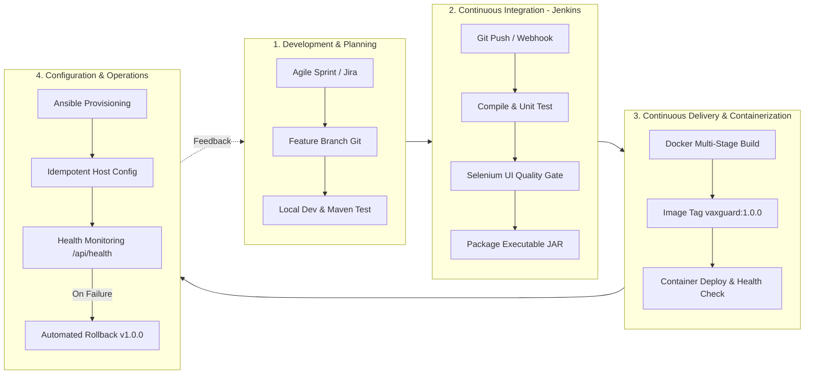

# TASK 02: Agile Planning and DevOps Workflow

**Student:** Gayatri Patil  
**PRN / Roll No:** 23102A0016 / Roll 15  
**Project:** Selenium Testing Pipeline for a Vaccination Reminder Portal (VaxGuard)  
**Deliverable:** User stories, acceptance criteria, product backlog, 15-task Kanban/Scrum plan, Definition of Done, and DevOps lifecycle diagram.

---

## 1. User Stories & Acceptance Criteria

### Story 1: Child Beneficiary Registration & Automated Schedule
- **As a** Parent or Clinical Healthcare Worker,
- **I want to** register a child's name, Date of Birth (DOB), gender, guardian details, and contact information,
- **So that** the system automatically generates their comprehensive national immunization timeline from birth to 24 months.
- **Acceptance Criteria:**
  - Date of Birth cannot be in the future.
  - Submitting registration automatically generates standard immunization milestones: BCG, HepB-0, OPV-0, Pentavalent (1,2,3), Rotavirus (1,2,3), PCV (1,2, booster), and MR (1,2).
  - All generated records are initially assigned status `SCHEDULED` (or `OVERDUE` if past scheduled milestone).

### Story 2: Role-Based Clinical Administration Workflow
- **As a** Healthcare Worker (Staff Nurse / Clinic Doctor),
- **I want to** select an upcoming or overdue vaccination and mark it as `COMPLETED`,
- **So that** the administration date, provider identity, and vaccine lot/batch number are officially recorded.
- **Acceptance Criteria:**
  - In Parent View, administration modification buttons are strictly disabled/read-only.
  - Healthcare Worker role enables the clinical administration modal dialog.
  - Marking `COMPLETED` records current date, administering nurse name, and vaccine batch number.

### Story 3: Summary Analytics & Compliance Dashboard
- **As a** Clinic Supervisor / Public Health Administrator,
- **I want to** view real-time KPI metrics and an immunization distribution chart,
- **So that** I can track total registered infants, completed vaccinations, upcoming doses, and overall compliance rate.
- **Acceptance Criteria:**
  - Dashboard dynamically updates total beneficiaries, completed, upcoming (7-day window), and overdue counts.
  - Interactive Chart.js doughnut chart visually represents status breakdown.
  - Compliance rate (%) dynamically calculates as: `(Completed Doses / Total Doses) * 100`.

### Story 4: Automated Selenium Quality Gate in CI/CD
- **As a** DevOps Engineer,
- **I want** every Git commit to automatically trigger a Selenium automated end-to-end regression test suite in Jenkins,
- **So that** any breaking UI defect or API validation error aborts deployment before reaching production.
- **Acceptance Criteria:**
  - All 5 user journeys execute in headless mode within Jenkins.
  - Test failures generate XML reports in `target/surefire-reports` and capture PNG screenshots in `target/screenshots`.
  - Deployment stage only triggers if all test assertions pass with 100% success rate.

---

## 2. Product Backlog & 15-Task Kanban Plan

| Task ID | Item Title | Story Points | Priority | Status |
| :---: | :--- | :---: | :---: | :---: |
| **TSK-01** | Problem definition, stakeholder analysis, frozen scope | 2 | High | **Done** |
| **TSK-02** | User stories, acceptance criteria, Kanban plan, DoD, DevOps lifecycle | 3 | High | **Done** |
| **TSK-03** | Application architecture, SRS summary, Maven Spring Boot setup | 5 | Critical | **Done** |
| **TSK-04** | Git repository initialization, `.gitignore`, branch policy, PR templates | 2 | High | **Done** |
| **TSK-05** | Feature 1 branch: Domain model, schedule generator, registration API | 5 | Critical | **Done** |
| **TSK-06** | Feature 2 branch: UI dashboard, status workflow, conflict resolution | 5 | Critical | **Done** |
| **TSK-07** | Jenkins installation, SCM polling trigger, Maven build job, artifact archive | 5 | Critical | **Done** |
| **TSK-08** | Declarative Jenkinsfile pipeline with parameterized environments | 5 | Critical | **Done** |
| **TSK-09** | Selenium WebDriver test design (5 journeys), failure screenshot listener | 8 | Critical | **Done** |
| **TSK-10** | Continuous testing quality gate in Jenkins, defect simulation & fix | 5 | Critical | **Done** |
| **TSK-11** | Multi-stage Dockerfile, image build/tag, container lifecycle scripts | 5 | High | **Done** |
| **TSK-12** | Jenkins-Docker CD pipeline: automated build, test gate, container rollout | 5 | High | **Done** |
| **TSK-13** | Ansible configuration management: inventory, roles, server setup | 5 | High | **Done** |
| **TSK-14** | Automated provisioning, idempotency validation, health probe, rollback | 5 | High | **Done** |
| **TSK-15** | End-to-end release documentation, architecture diagrams, viva dossier | 3 | High | **Done** |

---

## 3. Definition of Done (DoD)

A backlog item or feature is marked as **Done** only when:
1. **Code Quality:** Code complies with clean code principles, proper naming conventions, and package modularity.
2. **Automated Testing:** Selenium UI tests and unit tests are written and pass locally via `./mvnw test`.
3. **CI Pipeline Pass:** Code is pushed to Git, triggers Jenkins, and builds cleanly with 0 compilation errors and 0 test failures.
4. **Container Readiness:** Application successfully packages into a fat JAR and builds into a lightweight Docker image without root privileges.
5. **Quality Gate:** Automated screenshot capture mechanism verifies failure isolation in the event of UI regression.
6. **Documentation:** README, API endpoints, and configuration parameters are fully documented.

---

## 4. DevOps Lifecycle Diagram

The continuous delivery cycle connecting development, testing, packaging, provisioning, and operational monitoring:

