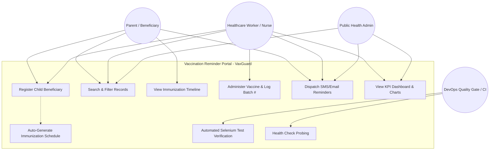
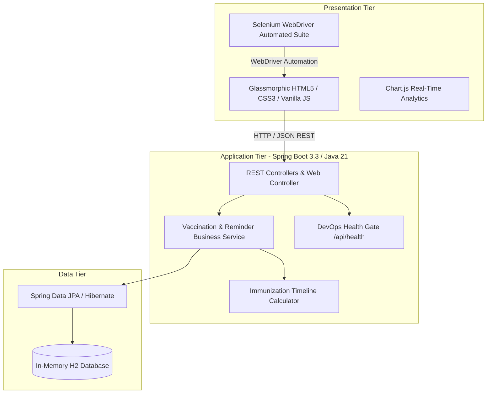

# TASK 03: Requirements, Architecture, and Technology Setup

**Student:** Gayatri Patil  
**PRN / Roll No:** 23102A0016 / Roll 16  
**Project:** Selenium Testing Pipeline for a Vaccination Reminder Portal (VaxGuard)  
**Deliverable:** SRS summary, use-case diagram, architecture diagram, data model/API list, and working local setup instructions.

---

## 1. Software Requirements Specification (SRS) Summary

### 1.1 Functional Requirements (FR)
- **FR-01 (Beneficiary Management):** System shall register child beneficiaries including Name, DOB, Gender, Parent Name, Phone, Email, and Address.
- **FR-02 (Immunization Engine):** System shall automatically calculate and populate standard vaccine schedules from DOB.
- **FR-03 (Search & Filter):** System shall provide real-time search across child name, parent phone, and vaccine type, with status filtering (`SCHEDULED`, `COMPLETED`, `OVERDUE`).
- **FR-04 (Role-Based Workflow):** System shall enforce role segregation between read-only Parent View and clinical administration Healthcare Worker mode.
- **FR-05 (Clinical Administration):** System shall record administration timestamp, provider name, batch number, and adverse reaction notes upon dose completion.
- **FR-06 (Reminder Simulation):** System shall simulate automated dispatch of individual and batch SMS/Email alerts for upcoming (7 days) and overdue doses.
- **FR-07 (Summary Analytics):** System shall dynamically compute and display total registered children, completed vaccinations, upcoming doses, overdue doses, and compliance rate.
- **FR-08 (DevOps Health Probe):** System shall expose an unauthenticated health probe endpoint at `/api/health` and `/actuator/health` reporting service status, version, and database state.

### 1.2 Non-Functional Requirements (NFR)
- **NFR-01 (Testability):** All interactive DOM elements must contain static, unique HTML `id` attributes to enable resilient Selenium WebDriver locators.
- **NFR-02 (Portability):** System must run self-contained on any Java 21 LTS host using embedded H2 in-memory storage without external RDBMS dependencies.
- **NFR-03 (Response Time):** API queries and search operations must respond in < 150 ms.
- **NFR-04 (Security):** Production Docker container must execute under an unprivileged non-root user (`vaxuser:vaxgroup`).

---

## 2. Use-Case Diagram



---

## 3. High-Level Application Architecture

The system follows a modern multi-tier layered architecture:



---

## 4. Data Model & REST API Catalog

### 4.1 Relational Data Model
1. **`beneficiaries` Table:**
   - `id` (BIGINT, Primary Key, Auto-increment)
   - `child_name` (VARCHAR, NOT NULL)
   - `date_of_birth` (DATE, NOT NULL)
   - `gender` (VARCHAR, NOT NULL)
   - `parent_name` (VARCHAR, NOT NULL)
   - `contact_phone` (VARCHAR, NOT NULL)
   - `contact_email` (VARCHAR)
   - `address` (VARCHAR)
   - `created_at` (TIMESTAMP)

2. **`vaccination_records` Table:**
   - `id` (BIGINT, Primary Key, Auto-increment)
   - `beneficiary_id` (BIGINT, Foreign Key references `beneficiaries.id`)
   - `vaccine_name` (VARCHAR, NOT NULL)
   - `target_disease` (VARCHAR)
   - `dose_number` (INT)
   - `scheduled_date` (DATE, NOT NULL)
   - `administered_date` (DATE, NULLABLE)
   - `status` (VARCHAR: `SCHEDULED`, `COMPLETED`, `OVERDUE`, `CANCELLED`)
   - `administered_by` (VARCHAR)
   - `batch_number` (VARCHAR)
   - `notes` (TEXT)
   - `reminder_sent_at` (TIMESTAMP)

### 4.2 REST API Endpoints

| HTTP Method | Endpoint URI | Description | Status Code |
| :--- | :--- | :--- | :--- |
| `GET` | `/api/beneficiaries` | Retrieve all registered children profiles | 200 OK |
| `POST` | `/api/beneficiaries` | Register a new child and auto-generate schedule | 200 OK / 400 Bad Request |
| `GET` | `/api/beneficiaries/{id}` | Retrieve specific child details by ID | 200 OK / 404 Not Found |
| `GET` | `/api/vaccinations` | Filter records by `search` and `status` | 200 OK |
| `PUT` | `/api/vaccinations/{id}/status` | Administer vaccine and transition status | 200 OK / 400 Bad Request |
| `POST` | `/api/vaccinations/{id}/reminder` | Trigger simulated SMS alert for single dose | 200 OK |
| `POST` | `/api/reminders/send-batch` | Dispatch batch SMS alerts to all due parents | 200 OK |
| `GET` | `/api/dashboard/stats` | Retrieve aggregate KPI metrics and charts | 200 OK |
| `GET` | `/api/health` | DevOps readiness and quality gate probe | 200 OK |
| `POST` | `/api/admin/defect-mode` | Toggle deliberate defect for Task 10 CI gate | 200 OK |

---

## 5. Working Local Development Setup

### 5.1 Prerequisites
- **JDK:** Java 21 LTS installed (`java -version`).
- **Build Tool:** Apache Maven 3.9+ (or included Maven Wrapper `./mvnw`).
- **Browser:** Google Chrome or Microsoft Edge with WebDriver.

### 5.2 Build and Run Commands
```bash
# 1. Clone repository
git clone https://github.com/gayatri-patil/vaccination-reminder-portal.git
cd vaccination-reminder-portal

# 2. Compile source code
./mvnw clean compile

# 3. Execute automated Selenium test suite
./mvnw test

# 4. Package executable fat JAR
./mvnw package -DskipTests

# 5. Launch application locally
java -jar target/vaccination-reminder-portal-1.0.0.jar
```
Application will be available locally at `http://localhost:8080`.
H2 Web Console: `http://localhost:8080/h2-console` (JDBC URL: `jdbc:h2:mem:vaxdb`, User: `sa`, Password: empty).
Health Check: `http://localhost:8080/api/health`.
