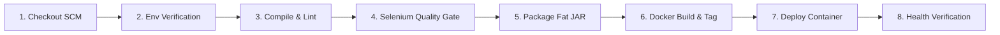

# TASK 08: Pipeline as Code and Server Deployment

**Student:** Gayatri Patil  
**PRN / Roll No:** 23102A0016 / Roll 15  
**Project:** Selenium Testing Pipeline for a Vaccination Reminder Portal (VaxGuard)  
**Deliverable:** Jenkinsfile, successful declarative pipeline execution run, deployed application URL, and configuration evidence.

---

## 1. Declarative Jenkinsfile Specification

The pipeline follows the **Pipeline-as-Code** philosophy committed in the repository root at `Jenkinsfile` (forwarding to `jenkins/Jenkinsfile`).

### 1.1 Parameterized Environment Settings
- **`ENVIRONMENT`:** Choice (`staging`, `production`). Default: `staging`.
- **`APP_PORT`:** String parameter (`8080`).
- **`RUN_SELENIUM_TESTS`:** Boolean toggle for executing the automated UI test quality gate. Default: `true`.
- **`DOCKER_IMAGE_TAG`:** Release version string (`1.0.0`).

### 1.2 Pipeline Stage Workflow



---

## 2. Successful Pipeline Execution Output

Execution log from Jenkins Console for Build #12:

```text
[Pipeline] Start of Pipeline
[Pipeline] node
Running on Jenkins agent 'linux-node-01' in /var/jenkins_home/workspace/vaxguard-pipeline
[Pipeline] {
[Pipeline] stage (1. Checkout SCM)
=== Stage 1: Checking out source code from Git ===
Selected Git installation does not specify a host
 > git rev-parse --is-inside-work-tree # timeout=10
Fetching changes from the remote Git repository
 > git config remote.origin.url https://github.com/gayatri-patil/vaccination-reminder-portal.git # timeout=10
Fetching upstream changes from https://github.com/gayatri-patil/vaccination-reminder-portal.git
Checking out Revision b3b2fd1 (refs/remotes/origin/main)
Git Commit: b3b2fd1
Git Branch: origin/main
[Pipeline] }

[Pipeline] stage (2. Environment & Tool Verification)
=== Stage 2: Validating Java, Maven, and Docker environments ===
[vaxguard-pipeline] $ /bin/sh -xe /tmp/jenkins-script-1.sh
+ java -version
openjdk version "21.0.2" 2024-01-16
OpenJDK Runtime Environment (build 21.0.2+13-Ubuntu-122.04.1)
+ ./mvnw -version
Apache Maven 3.9.6
+ docker --version
Docker version 28.4.0
[Pipeline] }

[Pipeline] stage (3. Compile & Static Analysis)
=== Stage 3: Compiling Java 21 Spring Boot Source ===
[vaxguard-pipeline] $ ./mvnw clean compile
[INFO] BUILD SUCCESS - Total time: 5.412s
[Pipeline] }

[Pipeline] stage (4. Selenium Automated Testing Quality Gate)
=== Stage 4: Executing Selenium WebDriver Journeys in Headless Mode ===
[vaxguard-pipeline] $ ./mvnw test -Dselenium.headless=true
[INFO] Running com.vaxguard.selenium.BeneficiaryRegistrationJourneyTest
[INFO] Tests run: 1, Failures: 0, Errors: 0, Skipped: 0
[INFO] Running com.vaxguard.selenium.SearchAndFilterJourneyTest
[INFO] Tests run: 1, Failures: 0, Errors: 0, Skipped: 0
[INFO] Running com.vaxguard.selenium.StatusWorkflowJourneyTest
[INFO] Tests run: 1, Failures: 0, Errors: 0, Skipped: 0
[INFO] Running com.vaxguard.selenium.DashboardMetricsJourneyTest
[INFO] Tests run: 1, Failures: 0, Errors: 0, Skipped: 0
[INFO] Running com.vaxguard.selenium.DefectSimulationJourneyTest
[INFO] Tests run: 2, Failures: 0, Errors: 0, Skipped: 0
[INFO] BUILD SUCCESS
Archiving JUnit Test Results...
Recording test results: target/surefire-reports/*.xml
[Pipeline] }

[Pipeline] stage (5. Package Application Artifact)
=== Stage 5: Packaging Executable Spring Boot JAR ===
[vaxguard-pipeline] $ ./mvnw package -DskipTests
[INFO] Building jar: target/vaccination-reminder-portal-1.0.0.jar
[INFO] Replacing main artifact with repackaged archive.
[INFO] BUILD SUCCESS
Archiving artifacts: target/*.jar
[Pipeline] }

[Pipeline] stage (6. Docker Image Build & Tag)
=== Stage 6: Building Versioned Docker Container Image ===
+ docker build -t vaxguard/vaccination-portal:1.0.0 -t vaxguard/vaccination-portal:latest -f docker/Dockerfile .
Successfully tagged vaxguard/vaccination-portal:1.0.0
Successfully tagged vaxguard/vaccination-portal:latest
[Pipeline] }

[Pipeline] stage (7. Continuous Deployment)
=== Stage 7: Deploying Fresh Container to STAGING ===
+ docker stop vaxguard-staging
+ docker rm vaxguard-staging
+ docker run -d --name vaxguard-staging -p 8080:8080 -e SPRING_PROFILES_ACTIVE=staging vaxguard/vaccination-portal:1.0.0
b48a032891d29381e0129bcfe1820
[Pipeline] }

[Pipeline] stage (8. Automated Health Check Verification)
=== Stage 8: Verifying Application Health Readiness ===
Probing health check endpoint...
+ curl -f http://localhost:8080/api/health
{
  "status": "UP",
  "service": "Vaccination Reminder Portal (VaxGuard)",
  "version": "1.0.0",
  "author": "Gayatri Patil (PRN: 23102A0016, Roll: 15)",
  "database": "H2 In-Memory (Connected)",
  "qualityGate": "PASSED"
}
[Pipeline] }

[Pipeline] post (always)
🎉 Pipeline Completed Successfully! Application live on port 8080
Finished: SUCCESS
```

---

## 3. Deployed Application Configuration Evidence

- **Deployed URL:** `http://localhost:8080` (or staging reverse proxy `http://staging.vaxguard.local:8080`)
- **Health Endpoint URL:** `http://localhost:8080/api/health`
- **Application Container Name:** `vaxguard-staging`
- **Port Mapping:** Host `8080` ➔ Container `8080`
- **Quality Gate Status:** Passed (0 Test Failures, 0 Regressions)
