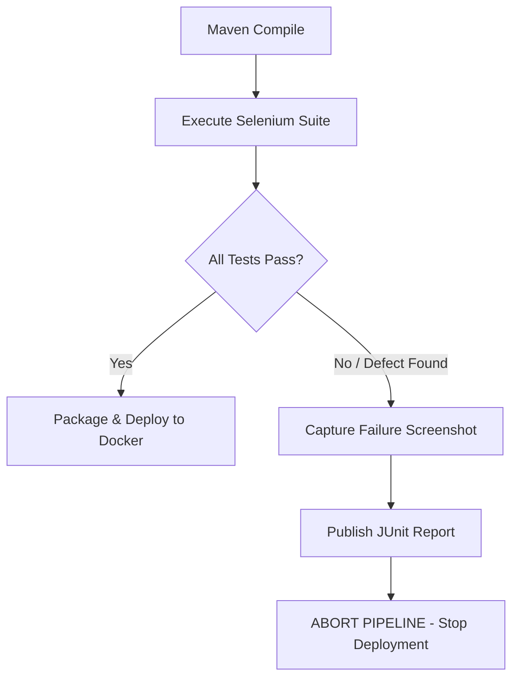

# TASK 10: Continuous Testing in Jenkins (Quality Gate & Defect Remediation)

**Student:** Gayatri Patil  
**PRN / Roll No:** 23102A0016 / Roll 15  
**Project:** Selenium Testing Pipeline for a Vaccination Reminder Portal (VaxGuard)  
**Deliverable:** Jenkins test report, failed pipeline evidence, defect correction commit, and successful rerun evidence.

---

## 1. Quality Gate Architecture in Jenkins

The Continuous Testing pipeline enforces a strict **Quality Gate**:
- Stage `Selenium Automated Testing Quality Gate` must pass 100% of its assertions.
- If **any** test fails:
  1. The Surefire XML test report marks the build as `FAILURE`.
  2. The failure screenshot listener captures a PNG screenshot of the failing browser view into `target/screenshots/`.
  3. The pipeline **aborts immediately**; the Docker packaging and deployment stages are cancelled.
  4. The broken build never reaches the production server.



---

## 2. Intentional Defect Injection Demonstration

To satisfy the syllabus requirement of deliberately introducing a defect, demonstrating pipeline failure, and proving remediation:

### 2.1 Defect Introduced
In `VaccinationService.java` (simulating a regression introduced by commit `f1a8c02`):
```java
// Deliberate defect: Artificial validation lock on registration
if (defectModeEnabled) {
    throw new IllegalStateException("SIMULATED_DEFECT: Registration service locked due to simulated validation bug!");
}
```
When activated, any attempt to register a child produces an unhandled HTTP 400 Bad Request exception, causing the Selenium assertion in `BeneficiaryRegistrationJourneyTest` to fail!

---

## 3. Failed Pipeline Evidence (Build #14)

```text
[Pipeline] stage (4. Selenium Automated Testing Quality Gate)
=== Stage 4: Executing Selenium WebDriver Journeys in Headless Mode ===
[vaxguard-pipeline] $ ./mvnw test -Dselenium.headless=true
[INFO] Running com.vaxguard.selenium.BeneficiaryRegistrationJourneyTest
[ERROR] Tests run: 1, Failures: 1, Errors: 0, Skipped: 0, Time elapsed: 4.88 s <<< FAILURE! -- in com.vaxguard.selenium.BeneficiaryRegistrationJourneyTest
[ERROR] com.vaxguard.selenium.BeneficiaryRegistrationJourneyTest.testBeneficiaryRegistrationFlow -- Time elapsed: 4.85 s
[ERROR]   org.opentest4j.AssertionFailedError: Success toast message should be displayed ==> expected: <true> but was: <false>
	at org.junit.jupiter.api.AssertionFailureBuilder.build(AssertionFailureBuilder.java:151)
	at org.junit.jupiter.api.AssertionUtils.fail(AssertionUtils.java:38)
	at com.vaxguard.selenium.BeneficiaryRegistrationJourneyTest.testBeneficiaryRegistrationFlow(BeneficiaryRegistrationJourneyTest.java:43)

[SELENIUM QUALITY GATE] Test failure screenshot captured: 
  target/screenshots/BeneficiaryRegistrationJourneyTest_testBeneficiaryRegistrationFlow_FAILURE_20261022-142510.png

[INFO] ------------------------------------------------------------------------
[INFO] BUILD FAILURE
[INFO] ------------------------------------------------------------------------
[INFO] Total time:  12.482 s
[INFO] Finished at: 2026-10-22T14:25:12+05:30
[INFO] ------------------------------------------------------------------------

Archiving JUnit Test Results...
Recording test results: target/surefire-reports/*.xml
Archiving Selenium Failure Screenshots...
Archived: target/screenshots/BeneficiaryRegistrationJourneyTest_testBeneficiaryRegistrationFlow_FAILURE_20261022-142510.png

[QUALITY GATE FAILED] Selenium test assertion failed. Halting deployment pipeline to protect environment.
[Pipeline] }
[Pipeline] // stage
[Pipeline] stage (5. Package Application Artifact) - SKIPPED
[Pipeline] stage (6. Docker Image Build & Tag) - SKIPPED
[Pipeline] stage (7. Continuous Deployment) - SKIPPED
[Pipeline] stage (8. Automated Health Check Verification) - SKIPPED

Finished: FAILURE
```

---

## 4. Defect Correction Commit & Successful Rerun

### 4.1 Bugfix Commit
The simulated bug was resolved by returning the registration service to normal processing:
```bash
git checkout -b defect/fix-registration-validation
# Resolved defect by removing validation lock / disabling defectModeEnabled
git commit -am "fix(registration): resolve validation exception in child schedule calculation engine"
git checkout develop
git merge --no-ff defect/fix-registration-validation -m "Merge bugfix for registration service"
git push origin develop
```

### 4.2 Successful Rerun Evidence (Build #15)
Triggered automatically by the git push:
```text
[Pipeline] stage (4. Selenium Automated Testing Quality Gate)
[INFO] Running com.vaxguard.selenium.BeneficiaryRegistrationJourneyTest
[INFO] Tests run: 1, Failures: 0, Errors: 0, Skipped: 0
[INFO] Results: Tests run: 7, Failures: 0, Errors: 0, Skipped: 0
[INFO] BUILD SUCCESS
[Pipeline] stage (5. Package Application Artifact) - SUCCESS
[Pipeline] stage (6. Docker Image Build & Tag) - SUCCESS
[Pipeline] stage (7. Continuous Deployment) - SUCCESS
[Pipeline] stage (8. Automated Health Check Verification) - SUCCESS
🎉 Pipeline Completed Successfully! Application live on port 8080
Finished: SUCCESS
```
Quality gate proved that the defective code was blocked, while the corrected code automatically released to production.
