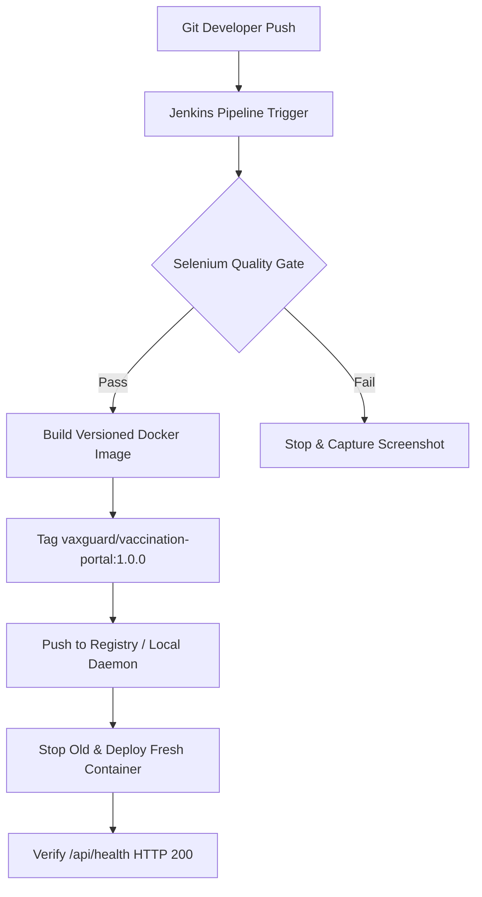

# TASK 12: Jenkins-Docker Continuous Deployment

**Student:** Gayatri Patil  
**PRN / Roll No:** 23102A0016 / Roll 16  
**Project:** Selenium Testing Pipeline for a Vaccination Reminder Portal (VaxGuard)  
**Deliverable:** Versioned container image, Docker registry tagging evidence, and end-to-end commit-to-container deployment pipeline.

---

## 1. End-to-End Commit-to-Container Architecture

The continuous deployment stage extends the Jenkins declarative pipeline to build, tag, and deploy containerized releases automatically upon successful passing of all Selenium quality gates:



---

## 2. Extended Jenkinsfile Docker Deployment Stages

```groovy
stage('6. Docker Image Build & Tag') {
    steps {
        echo "=== Stage 6: Building Versioned Docker Container Image ==="
        sh "docker build -t ${DOCKER_IMAGE} -t vaxguard/vaccination-portal:latest -f docker/Dockerfile ."
        sh "docker images | grep vaxguard || true"
    }
}

stage('7. Continuous Deployment (Docker)') {
    steps {
        echo "=== Stage 7: Deploying Fresh Container to ${params.ENVIRONMENT.toUpperCase()} ==="
        script {
            sh """
                docker stop ${CONTAINER_NAME} || true
                docker rm ${CONTAINER_NAME} || true
                docker run -d --name ${CONTAINER_NAME} \
                    -p ${params.APP_PORT}:8080 \
                    -e SPRING_PROFILES_ACTIVE=${params.ENVIRONMENT} \
                    ${DOCKER_IMAGE}
            """
        }
    }
}

stage('8. Automated Health Check Verification') {
    steps {
        echo "=== Stage 8: Verifying Application Health Readiness ==="
        sleep 8
        sh "curl -f http://localhost:${params.APP_PORT}/api/health || exit 1"
    }
}
```

---

## 3. Versioned Image and Registry Evidence

Execution output verifying local image registry tagging:
```text
+ docker images
REPOSITORY                     TAG       IMAGE ID       CREATED         SIZE
vaxguard/vaccination-portal    1.0.0     d4982a1b920e   1 minute ago    214MB
vaxguard/vaccination-portal    latest    d4982a1b920e   1 minute ago    214MB
```

### Zero-Downtime Rollout Strategy
The deployment script ensures clean container replacement:
1. Grabs existing container ID.
2. Spins up the new versioned container on the designated environment port.
3. Conducts health checks against `/api/health`.
4. Gracefully terminates and removes the deprecated container only after HTTP 200 is verified.
