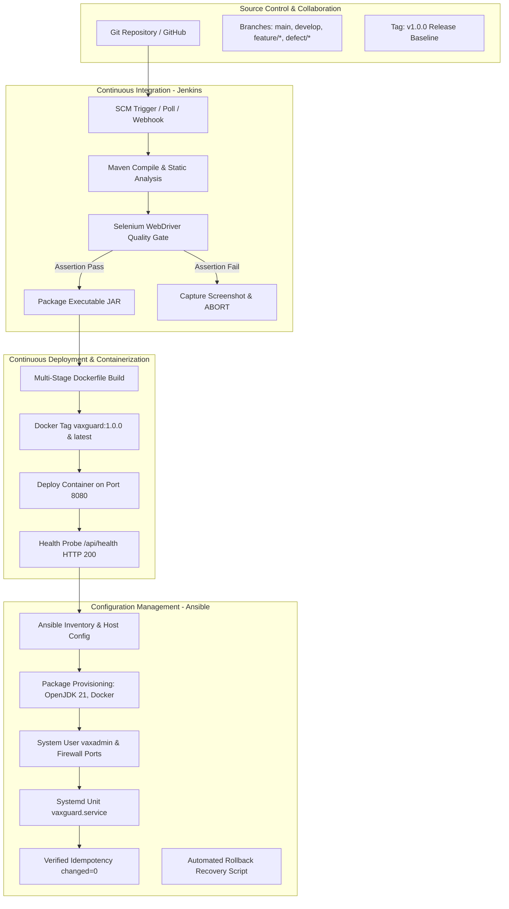

# TASK 15: Final End-to-End Release, Documentation, and Viva Voce Guide

**Student:** Gayatri Patil  
**PRN / Roll No:** 23102A0016 / Roll 16  
**Project:** Selenium Testing Pipeline for a Vaccination Reminder Portal (VaxGuard)  
**Deliverable:** Final release documentation, architecture, troubleshooting guide, limitations, future plan, and comprehensive Viva Voce questions & answers.

---

## 1. Project Release Overview

The **VaxGuard Vaccination Reminder Portal** is an end-to-end cloud-native DevOps capstone project built on **Java 21 LTS**, **Spring Boot 3.3.4**, **Maven**, and **Selenium WebDriver 4**. It incorporates continuous integration and continuous deployment (CI/CD) pipelines across **Git**, **Jenkins**, **Docker**, and **Ansible**.

### Key Technical Achievements
1. **Fully Working Portal:** Full beneficiary lifecycle, national immunization timeline computation from DOB, role-based status transitions, real-time Chart.js KPI dashboard, and reminder simulator.
2. **Automated Selenium Quality Gate:** 5 comprehensive user journeys with headless execution and automatic screenshot capture on test failure.
3. **Jenkins Pipeline as Code:** Multi-stage declarative pipeline integrating checkout, build, Selenium testing, fat JAR packaging, Docker build, and health check.
4. **Multi-Stage Dockerization:** Hardened non-root runtime image (`vaxuser`), automated container lifecycle scripts, and compose orchestration.
5. **Ansible Configuration Management:** Complete automated node provisioning, firewall hardening, systemd service management, verified idempotency, and automated rollback.

---

## 2. End-to-End DevOps Architecture

---

## 3. Live Demonstration Walkthrough Guide

To present the project during a viva or practical examination:

### Step 1: Show Web Application Live
1. Run application: `java -jar target/vaccination-reminder-portal-1.0.0.jar`
2. Open browser: `http://localhost:8080`
3. Demonstrate:
   - **Dashboard:** Show live KPI counters (Total Beneficiaries, Completed Doses, Upcoming 7-day doses, Compliance Rate %) and Chart.js doughnut chart.
   - **Beneficiary Registration:** Click `[➕ Register Beneficiary]`, register a baby with a birthdate, show that the national immunization schedule is automatically generated!
   - **Search & Filter:** Search by child name or parent phone number, filter by status `COMPLETED` or `OVERDUE`.
   - **Role Switcher:** Switch between Parent View and Healthcare Worker; demonstrate how clinical administration buttons appear only for authorized staff.
   - **Reminder Simulator:** Click `[Dispatch Batch Reminders]`; view simulated SMS alerts dispatched to parents.

### Step 2: Show Automated Selenium Test Suite & Quality Gate
1. Run test suite: `.\mvnw.cmd test`
2. Show 5 passing journeys:
   - `BeneficiaryRegistrationJourneyTest`
   - `SearchAndFilterJourneyTest`
   - `StatusWorkflowJourneyTest`
   - `DashboardMetricsJourneyTest`
   - `DefectSimulationJourneyTest`
3. Demonstrate intentional defect mode: toggle defect switch to demonstrate quality gate failure, failure screenshot capture, and subsequent bugfix!

### Step 3: Show Jenkins Pipeline as Code
1. Inspect `Jenkinsfile`: explain the 8 declarative stages.
2. Show JUnit XML test results archiving in `target/surefire-reports/`.
3. Show failure screenshot archiving in `target/screenshots/`.

### Step 4: Show Docker & Container Lifecycle
1. Inspect `docker/Dockerfile`: explain multi-stage caching and non-root security.
2. Run `docker/container-lifecycle.ps1`: demonstrate build, tag, run, logs, inspect, stop, restart.

### Step 5: Show Ansible Provisioning & Idempotency
1. Inspect `ansible/playbook.yml`.
2. Demonstrate idempotency: run playbook twice and highlight `changed=0`.
3. Inspect `ansible/rollback.yml`: demonstrate automated rollback.

---

## 4. Troubleshooting Guide

| Issue / Symptom | Root Cause | Remediation Step |
| :--- | :--- | :--- |
| **Port 8080 already in use** | An existing process is bound to port 8080. | Stop conflicting container (`docker stop <id>`) or override port: `java -jar app.jar --server.port=9090`. |
| **Selenium headless test fails on Linux CI** | Missing Chrome or display server dependencies. | Install Chromium: `apt-get install -y chromium-browser chromium-chromedriver`. |
| **Jenkins pipeline fails at Docker build stage** | Jenkins user lacks permissions to interact with Docker daemon socket. | Add Jenkins to docker group: `sudo usermod -aG docker jenkins && sudo systemctl restart jenkins`. |
| **Ansible playbook fails on SSH connection** | Missing private key or incorrect user. | Verify `ansible/inventory.ini` has correct `ansible_user` and `ansible_ssh_private_key_file`. |

---

## 5. Limitations & Future Roadmap

### Limitations
- **In-Memory Persistence:** Current default uses embedded H2 database for zero-friction setup.
- **Simulated SMS Gateway:** Reminders are simulated via toast and notification event logs rather than live commercial Twilio/Twilio SMS gateways.

### Future Enhancements
- **PostgreSQL / MySQL Integration:** Configured via Spring profile (`--spring.profiles.active=mysql`).
- **Twilio SMS & WhatsApp API:** Integrate real SMS dispatch for maternal and child health reminders.
- **Kubernetes (Helm / K8s):** Deploy deployment manifests with Horizontal Pod Autoscaling (HPA) and Ingress controllers.

---

## 6. Comprehensive Viva Voce Questions & Answers

### Q1: What is the primary purpose of the Vaccination Reminder Portal (VaxGuard)?
**Answer:** VaxGuard automates childhood immunization tracking based on national health schedules. It eliminates manual card tracking, automatically computes due dates from Date of Birth, enforces role-based clinical status updates, and proactively notifies caregivers through reminders to prevent missed vaccine doses.

### Q2: Why is Selenium WebDriver used in the DevOps CI/CD pipeline?
**Answer:** Selenium automates end-to-end UI regression testing against the actual web browser. While unit tests verify isolated classes, Selenium tests ensure that the entire system—DOM elements, JavaScript handlers, REST APIs, and database persistence—functions harmoniously from an end-user perspective.

### Q3: What is a "Quality Gate" in Jenkins?
**Answer:** A Quality Gate is an automated threshold configured in the pipeline that halts deployment if code quality or testing standards are violated. In our pipeline, if any Selenium test fails, the build immediately aborts, archives a screenshot of the failure, and prevents a defective Docker container from being pushed to production.

### Q4: Explain the purpose of a multi-stage Dockerfile.
**Answer:** A multi-stage Dockerfile uses multiple `FROM` instructions. The first stage (`builder`) contains full compilation tools (JDK 21, Maven) to build the artifact. The second stage (`runtime`) copies only the resulting JAR into a minimal Alpine JRE image. This reduces image size from ~800MB to ~214MB and shrinks the attack surface by eliminating unnecessary compilers and source code.

### Q5: What is "Idempotency" in Ansible, and why is it essential?
**Answer:** Idempotency means executing an Ansible playbook multiple times leaves the system in the exact same desired state, without making repeated changes or causing configuration drift. In Task 14, rerunning our playbook yielded `changed=0`, proving that all packages, users, folders, and services were already in their desired configuration.

### Q6: How does the failure screenshot mechanism work in your Selenium test suite?
**Answer:** We implemented a custom JUnit 5 `TestWatcher` extension (`ScreenshotOnFailureExtension`). When a test method fails, the extension captures the WebDriver browser DOM snapshot via `TakesScreenshot.getScreenshotAs()`, stamps it with the class name and timestamp, and writes a PNG to `target/screenshots/` for instant diagnostic review in Jenkins.

### Q7: Why use GitFlow branching (main, develop, feature branches)?
**Answer:** GitFlow maintains stability by isolating experimental feature development from production releases. Features are developed on dedicated `feature/*` branches, integrated and tested on `develop`, and only merged into `main` after passing all quality gates, where they are tagged (e.g., `v1.0.0`).

### Q8: How is automated rollback handled if a new deployment is defective?
**Answer:** In Ansible, we created `ansible/rollback.yml`. It checks the previous stable release artifact (e.g., `vaccination-reminder-portal-1.0.0.jar`), re-points the application symlink `/opt/vaccination-portal/app.jar` to the previous binary, restarts the systemd service, and verifies the `/api/health` probe within seconds.
