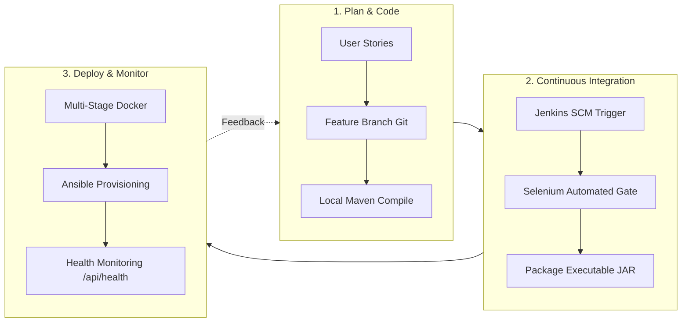

# Task 02: Agile Planning and DevOps Workflow
## DevOps Laboratory Assignment & Viva Voce Document

**Student Name:** Gayatri Patil  
**PRN / Student ID:** 23102A0016  
**Roll Number:** 15  
**Class / Semester:** TE Computer Engineering / DevOps Lab  
**Project Title:** Selenium Testing Pipeline for a Vaccination Reminder Portal (VaxGuard)  

---

### 1. Aim of the Experiment
To create user stories with clear acceptance criteria for the Vaccination Reminder Portal, prepare a prioritized product backlog, construct a 15-task Kanban/Scrum plan, establish a Definition of Done (DoD), and design an end-to-end DevOps lifecycle diagram.

---

### 2. Syllabus Deliverable Requirement
> *"Backlog, task board, sprint plan, Definition of Done and DevOps workflow diagram."*

---

### 3. Step-by-Step Guide: What to Show the Teacher

#### Step 1: Explain Agile Planning to Teacher
- **Speech Script:**
  > *"Madam/Sir, in Task 2, I organized the development using Agile user stories. I established clear acceptance criteria for each story, built a 15-task product backlog with story points, defined our Definition of Done (DoD), and illustrated the continuous feedback loop in our DevOps lifecycle."*

#### Step 2: Show Key User Stories with Acceptance Criteria
Show these user stories on screen:
1. **Story 1 (Child Registration & Auto Schedule):**
   - *As a* Parent / Healthcare Worker, *I want to* register a baby with Date of Birth, *so that* the system auto-calculates 16 national immunization milestones.
   - *Acceptance Criteria:* Date of Birth cannot be in the future; schedule includes BCG, HepB, OPV, Pentavalent, Rotavirus, PCV, and MR.
2. **Story 2 (Role-Based Administration):**
   - *As a* Clinical Nurse, *I want to* mark a scheduled dose as `COMPLETED`, *so that* the clinical provider name and vaccine batch/lot number are logged.
   - *Acceptance Criteria:* Parent View is read-only; Healthcare Worker mode unlocks the administration form.
3. **Story 3 (Selenium Quality Gate):**
   - *As a* DevOps Engineer, *I want* every commit to run automated Selenium tests, *so that* UI regressions are blocked before deployment.

#### Step 3: Show the Definition of Done (DoD)
A story is marked **Done** only when:
- [x] Code adheres to clean naming conventions and Spring Boot structure.
- [x] 100% of headless Selenium tests pass in Maven.
- [x] Jenkins build succeeds with zero compile or test errors.
- [x] Non-root multi-stage Docker container builds successfully.
- [x] Application passes `/api/health` probe with HTTP 200 OK.

#### Step 4: Show the DevOps Lifecycle Diagram
Show the Mermaid diagram on screen:

---

### 4. Likely Viva Voce Questions & Answers for Task 2

**Q1: What is the difference between Agile and DevOps?**  
*Answer:* Agile focuses on iteratively developing and delivering software through user stories and collaboration between developers and product owners. DevOps extends Agile by bridging the gap between development and operations through automation (continuous integration, automated testing, containerization, and monitoring).

**Q2: What is the difference between a Product Backlog and a Sprint Backlog?**  
*Answer:* The Product Backlog is an prioritized list of all features and requirements for the entire product. The Sprint Backlog is a specific subset of backlog items selected for completion in the current sprint.

**Q3: Why is a Definition of Done (DoD) critical in DevOps?**  
*Answer:* Without a strict DoD, code might be labeled "done" when coding finishes, even if it has no automated tests or breaks during deployment. DoD ensures that testing, packaging, and health verification are completed before code is released.
