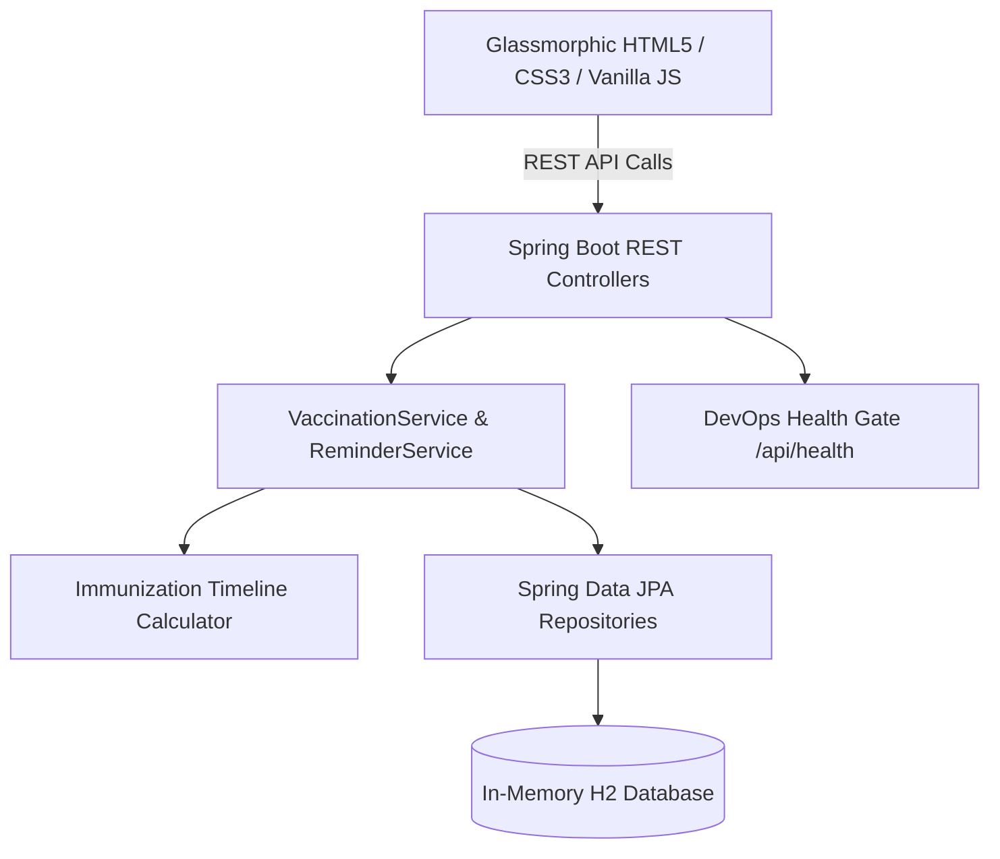

# Task 03: Requirements, Architecture, and Technology Setup
## DevOps Laboratory Assignment & Viva Voce Document

**Student Name:** Gayatri Patil  
**PRN / Student ID:** 23102A0016  
**Roll Number:** 15  
**Class / Semester:** TE Computer Engineering / DevOps Lab  
**Project Title:** Selenium Testing Pipeline for a Vaccination Reminder Portal (VaxGuard)  

---

### 1. Aim of the Experiment
To design the minimum application architecture for the Vaccination Reminder Portal (covering create, view, update, search, role-based status workflow, and summary dashboard), select the technology stack and build tools (Java 21, Spring Boot 3.3.4, Maven), configure in-memory storage, setup deployment targets, and establish a working local development environment.

---

### 2. Syllabus Deliverable Requirement
> *"SRS summary, use-case diagram, architecture diagram, data model/API list and working local setup."*

---

### 3. Step-by-Step Guide: What to Show the Teacher

#### Step 1: Explain Technology Stack Selection
- **Speech Script:**
  > *"Madam/Sir, in Task 3, I selected a modern Java 21 LTS stack with Spring Boot 3.3.4 and Maven 3.9. For database persistence, I chose an embedded in-memory H2 database, which guarantees that our entire CI/CD pipeline and Jenkins agent can build, test, and run the portal immediately without needing any external database service installed."*

#### Step 2: Show the High-Level Architecture Diagram
Show this architecture diagram on screen:



#### Step 3: Show the REST API Endpoints Table
Show the core API endpoints:
- `GET /api/beneficiaries` - Retrieve registered children
- `POST /api/beneficiaries` - Register child and generate vaccination schedule
- `GET /api/vaccinations` - Filter records by status and search keyword
- `PUT /api/vaccinations/{id}/status` - Clinical administration & status update
- `POST /api/reminders/send-batch` - Dispatch simulated batch reminders
- `GET /api/dashboard/stats` - Summary KPI counts and compliance percentage
- `GET /api/health` - DevOps readiness and health verification

#### Step 4: Run the Terminal Verification Command
Run this in PowerShell:
```powershell
Invoke-RestMethod -Uri "http://localhost:8080/api/health" -Method Get
```

#### Step 5: What Output to Point To:
Show the JSON response on screen:
```json
{
  "status": "UP",
  "service": "Vaccination Reminder Portal (VaxGuard)",
  "version": "1.0.0",
  "author": "Gayatri Patil (PRN: 23102A0016, Roll: 15)",
  "database": "H2 In-Memory (Connected)",
  "qualityGate": "PASSED"
}
```

---

### 4. Likely Viva Voce Questions & Answers for Task 3

**Q1: Why did you choose Maven over Gradle?**  
*Answer:* Maven enforces a standard project directory structure (`src/main/java`, `src/test/java`) and declarative XML configuration (`pom.xml`). It integrates natively with the Maven Surefire Plugin to produce JUnit XML reports that Jenkins consumes directly.

**Q2: What is Spring Boot Actuator?**  
*Answer:* Spring Boot Actuator provides production-ready monitoring and telemetry endpoints (like `/actuator/health` and `/actuator/info`) that allow container orchestrators (Docker, Kubernetes) and CI/CD pipelines to verify application readiness without writing manual monitoring code.

**Q3: How does the H2 in-memory database work?**  
*Answer:* H2 is an embedded relational database written in Java. When configured with `jdbc:h2:mem:vaxdb`, it runs inside the Java Virtual Machine (JVM) memory. It requires zero configuration, zero ports, and is destroyed and recreated automatically during test execution.
